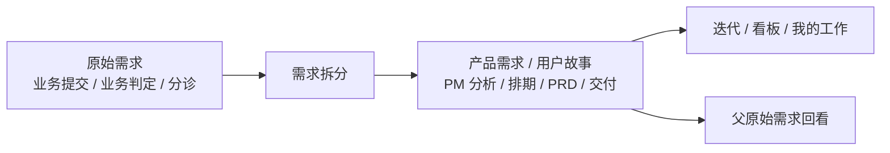

# 原始需求池与产品需求池 UE 优化需求文档

> 迭代：`2606_4 / F1_Linear_UE_Redesign`
> 范围：原始需求池、产品需求池
> 阶段：可评审原型，不直接授权生产前端、后端接口、数据库结构改动。

## 1. 背景与目标

当前需求管理链路包含两个核心对象：

- 原始需求：来自内部或外部提交的业务诉求，承载提交背景、业务判定、分诊与拆分动作。
- 产品需求 / 用户故事：由原始需求拆分或产品经理直接创建，承载产品经理分析、验收口径、排期、PRD、交付材料和持续跟进。

本次 UE 优化目标是让两个页面共享同一套 Linear 风格工作语言：安静侧栏、紧凑列表、标签化信息、Space Peek、行点击详情、就地编辑、日期选择器和稳定空状态。

## 2. 对象关系

## 3. 原始需求池

### 3.1 页面定位

原始需求池是需求进入系统后的分诊工作台。用户在这里快速扫描业务诉求，查看提交背景和业务判定，必要时进入详情进行需求拆分。

### 3.2 列表字段

| 字段 | 说明 | 交互 |
|---|---|---|
| 需求标题 / 需求编号 | 主识别信息；标题不可在列表直接编辑 | 行点击进入详情 |
| 需求单入口 | 扁平图标，兼容外链或系统内置页面 | 点击不进入详情 |
| 业务线 | 分诊归属 | 单元格浮层编辑 |
| 状态 | 待评估、待设计、已设计、开发中、已上线、验收不通过、拒绝 | 拒绝需填写原因 |
| 优先级 | P0-P3 | 单元格浮层编辑 |
| 产品经理 | 产品承接人 | 纯文本人员菜单 |
| 项目经理 | 项目侧负责人 | 纯文本人员菜单 |
| 提出人 | 需求提出方 | 纯文本人员菜单 |
| 期望上线时间 | 业务期望日期 | 日期选择器 |
| 创建时间 | 创建日期 | 日期选择器 |

### 3.3 Peek

- 触发：hover 行后按 Space。
- 长按 Space：固定 Peek。
- 再次 Space：关闭 Peek。
- 上下方向键：切换 Peek 内容。
- 内容顺序：
  - 需求描述
  - 业务提交
  - 业务判定
  - 关联产品需求
  - 活动记录
- 操作区只保留：详情。

### 3.4 详情页

详情页展开所有业务板块：

- 主档字段
- 业务提交
- 业务判定
- 需求拆分
- 历史活动记录

需求拆分支持：

- 展示已拆分产品需求
- 生成建议拆分项
- 新增产品需求拆分项
- 编辑拆分项标题、产品经理、优先级、状态
- 删除拆分项

## 4. 产品需求池

### 4.1 页面定位

产品需求池不再只是“拆分结果列表”，而是产品经理持续维护用户故事的工作台。原始需求池中拆出的条目在产品池中被视为用户故事，产品经理围绕它补充分析、验收口径、排期和交付材料。

### 4.2 列表组织

默认使用状态分组 + 标签化管理：

- 状态分组：Todo、Active、Done、Blocked、Voided。
- 左侧主锚点：产品需求编号、用户故事标题、父原始需求提示。
- 右侧标签：类型、业务线、优先级、处理人、所属迭代、PRD、项目 / 父需求。

无效的行级圆圈操作不展示，除非后续确认具体状态流转动作。

### 4.3 列表交互

| 能力 | 说明 |
|---|---|
| 顶部新建产品需求 | 新增一条 Todo / 待设计 用户故事，并立即显示 |
| 分组 `+` | 在对应状态分组下新增一条用户故事，并立即显示 |
| 标签编辑 | 类型、业务线、优先级、处理人、所属迭代支持浮层编辑 |
| PRD 标签 | 点击触发 PRD 入口占位，不进入详情 |
| 项目 / 父需求标签 | 打开轻量父原始需求预览 Drawer |
| 未排期视图 | 按所属迭代为“未排期”筛选，不把未排期混作状态 |

### 4.4 Peek 信息架构

产品需求池 Peek 采用 story-first 信息架构：

1. 用户故事
2. 产品经理分析
3. 原始需求追加说明
4. 辅助判断信息
5. 父需求与业务字段
6. 排期、价值与材料
7. 活动记录

状态、优先级、处理人、迭代、PRD、父需求等信息都是辅助判断信息，不占据主阅读区。

### 4.5 详情页信息架构

详情页与 Peek 保持同一对象含义和顺序：

1. 用户故事
2. 产品经理分析
3. 原始需求追加说明
4. 辅助判断信息
5. 父需求与业务字段
6. 排期、价值与材料
7. 价值回归 / 补充记录
8. 历史活动记录

## 5. 共性交互规则

- 页面壳：左侧安静导航 + 顶部单行工具栏 + 主工作区。
- 搜索：支持编号、标题、负责人、业务线、状态、迭代等字段。
- 筛选：浮层形式，不长期占用主工作区。
- 显示设置：支持密度切换与字段显示预览。
- 就地编辑：默认阅读态，hover / 点击后出现编辑浮层。
- 日期字段：使用日期选择器，不使用普通下拉。
- Space Peek：与筛选、字段菜单、详情页、原因弹窗、父需求 Drawer 互斥，禁止多层 Peek 叠加。
- 空状态：保持工具栏、表头和工作区结构稳定。

## 6. 验收标准

- 原始需求池与产品需求池视觉上像同一套工作台。
- 两页均不出现传统后台式操作列。
- 原始需求池保留业务提交、业务判定、需求拆分的主链路。
- 产品需求池以用户故事为对象核心，Peek 和详情页均 story-first。
- 产品需求池支持顶部新建和分组新建，新增后可立即看到并可打开 Peek / 详情。
- 产品需求池无效行级圆圈操作已移除。
- Space Peek 不再出现多层弹窗。
- 原型阶段不引入后端 API、路由或生产 Vue 文件改动。

## 7. 原型入口

- 合并入口：`Prototypes/requirement-pools.html`
- 原始需求池：`Prototypes/raw-pool-linear.html`
- 产品需求池：`Prototypes/product-pool-linear.html`
