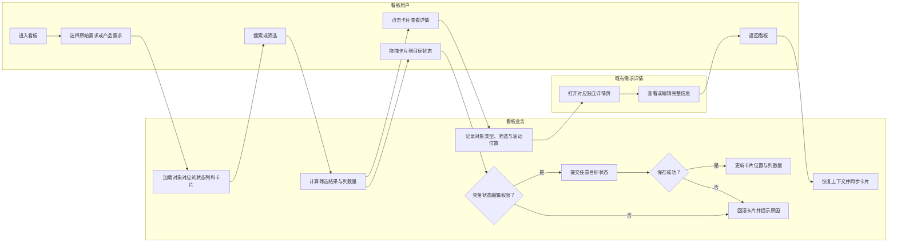

# F1 看板视图迭代—业务流程

## 1. 流程逻辑

用户进入统一看板后选择需求对象，系统按该对象的状态集合组织卡片。用户可以通过筛选聚焦范围，也可以将有权限编辑的卡片拖至任意状态。完整信息始终进入独立详情页，返回时恢复工作上下文。

## 2. 查看、流转与详情闭环

## 3. 状态变化规则

- 原始需求和产品需求分别使用现有状态集合。
- 任意现有状态均可转到任意其他现有状态。
- 本期不新增审批节点或强制前后置状态。
- 权限不足、记录已删除或保存失败时，需求状态保持原值。

