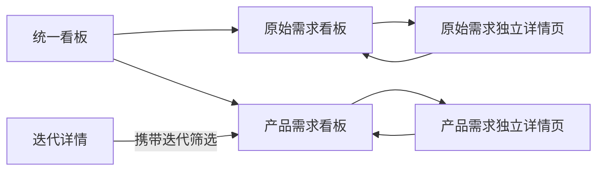

# PRD：看板视图迭代 2607_1

## 1. 文档信息

| 版本号 | 变更日期 | 变更内容 | 变更人 |
|---|---|---|---|
| v1.0 | 2026-07-20 | 基于已确认背景、概念设计和交互原型生成首版 PRD | 产品经理 |

### 1.1 关联文档链接

- [需求背景](./Background/Requirement_Background.md)
- [现有系统调研](./Background/System_Survey.md)
- [概念设计](./Background/Concept_Design.md)
- [用户故事](./Background/User_Stories.md)
- [用户旅程](./Flow/User_Journey_Map.md)
- [业务流程](./Flow/Business_Flow.md)
- [页面结构](./Page_Structure.md)
- [高保真交互原型](./Prototypes/kanban.html)

## 2. 项目概述

### 2.1 背景

当前系统同时管理原始需求和产品需求，但现有看板的信息层级与空间利用不适合持续跟踪工作状态，且选中卡片后出现右侧常驻信息栏，压缩了状态列宽度。本需求在不调整现有角色权限和需求状态集合的前提下，将看板升级为单页双对象、全宽展示的执行工作区。

### 2.2 产品目标

- 在一个统一入口中分别查看原始需求和产品需求。
- 以状态列直观呈现需求分布。
- 通过拖拽完成任意状态互转。
- 保持看板全宽，完整详情进入独立详情页。
- 进入详情后返回时恢复原工作上下文。

### 2.3 成功标准

- 用户可在同一页面完成两类需求看板切换。
- 有权限用户可将卡片拖至任意状态列并成功保存。
- 状态保存失败时，卡片能够准确回滚。
- 选中卡片前后看板宽度保持一致。
- 返回看板后对象、筛选和滚动位置得到恢复。

### 2.4 范围

#### 本期包含

- 原始需求/产品需求对象切换。
- 按状态分列的全宽看板。
- 搜索、业务字段筛选及筛选条件清除。
- 卡片拖拽状态更新、失败回滚和局部反馈。
- 独立需求详情页跳转及看板上下文恢复。
- 从迭代进入带迭代筛选的产品需求看板。

#### 本期不包含

- 角色权限重构。
- 自定义状态工作流。
- 自定义分组、泳道和私人保存视图。
- 原始需求与产品需求混排。
- 右侧常驻详情栏、判断栏或信息汇总栏。
- 复杂统计报表。

## 3. 用户角色与故事

| 角色 | 核心目标 | 本期权限处理 |
|---|---|---|
| 产品经理 | 查看产品需求执行状态并推进工作 | 沿用现有权限 |
| 产品负责人 | 观察两类需求分布和重点事项 | 沿用现有权限 |
| 项目经理 | 查看授权范围内的原始需求与看板 | 沿用现有权限 |
| 其他授权角色 | 查看或操作其现有权限允许的需求 | 本期不新增角色 |

核心用户故事包括：

- 在同一页面切换原始需求和产品需求。
- 按状态查看全量需求。
- 通过搜索和筛选聚焦关注项。
- 将卡片拖至任意目标状态。
- 进入独立详情并无损返回看板。
- 从迭代进入对应的产品需求看板。

详细验收标准见[用户故事](./Background/User_Stories.md)。

## 4. 业务流程

### 4.1 核心流程

1. 用户进入看板。
2. 系统恢复最近对象，或读取迭代入口携带的上下文。
3. 用户切换原始需求/产品需求并设置筛选。
4. 系统按对象的现有状态集合分列展示卡片。
5. 用户拖拽卡片更新状态，或进入独立详情页。
6. 系统保存状态；失败时回滚。
7. 用户从详情返回后恢复看板上下文。

完整业务流程见[业务流程](./Flow/Business_Flow.md)。

## 5. 页面结构与流转

### 5.1 页面流转逻辑

### 5.2 页面层级

| 页面 | 处理方式 | 说明 |
|---|---|---|
| 看板视图 | 改造 | 单页双对象、全宽状态列 |
| 原始需求详情 | 复用 | 承载原始需求完整信息 |
| 产品需求详情 | 复用 | 承载产品需求完整信息 |
| 迭代详情 | 联动 | 可进入带迭代上下文的产品需求看板 |

## 6. 名词字典与全局规则

### 6.1 名词字典

| 术语 | 定义 |
|---|---|
| 看板对象 | 当前看板承载的需求类型，取值为原始需求或产品需求 |
| 状态列 | 对应当前对象现有状态值的纵向卡片容器 |
| 卡片 | 单条原始需求或产品需求在看板中的紧凑表达 |
| 看板上下文 | 对象类型、搜索词、筛选条件、横向滚动位置和纵向滚动位置 |
| 任意状态互转 | 需求可从任一现有状态变更为其他任一现有状态，不增加前后置状态限制 |
| 迭代上下文 | 从迭代详情进入看板时携带的迭代 ID 和筛选条件 |

### 6.2 全局数据规则

| 规则项 | 定义 |
|---|---|
| 对象隔离 | 原始需求和产品需求不在同一列组中混排 |
| 状态来源 | 分别读取两类需求的现有状态字典 |
| 状态权限 | 是否可更新状态沿用现有权限校验 |
| 卡片排序 | 列内先按优先级从高到低，再按更新时间倒序 |
| 空优先级 | 无优先级卡片排在所有已设置优先级卡片之后 |
| 数量统计 | 列头数量基于当前对象及当前筛选结果计算 |
| 筛选组合 | 多个筛选条件按“且”关系组合 |
| 详情承载 | 完整需求信息由独立详情页承载 |

## 7. 功能详细说明

### 7.1 看板页面框架

- **原型链接**：[看板视图](./Prototypes/kanban.html)

#### 数据来源与逻辑

- 页面访问权限读取现有菜单和角色权限。
- 最近对象类型可读取用户侧视图偏好；无记录时使用系统既有默认值。
- 从迭代详情进入时，优先使用入口携带的产品需求对象及迭代 ID。

#### 交互规则

- 页面标题显示“看板视图”和当前结果总数。
- 标题后直接进入对象切换和工具栏，不展示大尺寸摘要卡。
- 主内容区始终全宽。
- 选中卡片、拖拽卡片或打开快捷操作时不得改变状态列宽度。

#### 异常与兜底

- 无页面权限时显示统一无权限状态。
- 首次加载失败时显示错误原因和重试入口。
- 不允许在页面右侧降级展示常驻详情面板。

### 7.2 对象类型切换

#### 数据来源与逻辑

- 对象取值仅为“原始需求”“产品需求”。
- 切换对象后重新加载对应状态、筛选字段和卡片字段。
- 两类对象分别维护当前页面内的查询结果。

#### 交互规则

- 使用分段控件展示两个对象。
- 当前对象必须有明确选中态。
- 从迭代进入时默认选择产品需求。
- 切换对象后清理不适用于目标对象的筛选项。

#### 异常与兜底

- 某类对象无访问权限时，不展示对应切换项或展示统一无权限结果，遵循现有权限策略。
- 切换加载失败时保留原对象数据，不展示不完整的新对象看板。

### 7.3 搜索与筛选工具栏

#### 数据来源与逻辑

- 通用搜索字段：需求编号、标题。
- 通用筛选：优先级、业务线、负责人。
- 产品需求专属筛选：所属迭代。
- 搜索与筛选按“且”关系组合。

#### 交互规则

- 搜索词变化后更新各列结果和数量。
- 已选筛选以可删除标签展示。
- 支持逐项移除和一键清除。
- 产品需求切换为原始需求时自动移除所属迭代筛选。

#### 异常与兜底

- 无结果时保留筛选条件，并提供清除筛选入口。
- 筛选字典加载失败时禁用对应筛选，不影响已有卡片查看。

### 7.4 状态列

#### 数据来源与逻辑

- 原始需求读取原始需求现有状态集合。
- 产品需求读取产品需求现有状态集合。
- 列头数量只统计当前筛选结果。
- 状态列按现有字典排序值排列。

#### 交互规则

- 每个有效状态始终保留一列，包括无卡片的空列。
- 超出可用宽度时看板支持横向滚动。
- 空列仍是合法拖拽目标。
- 列宽稳定，不因卡片选中或空状态改变。

#### 异常与兜底

- 状态字典为空或加载失败时不渲染错误列，展示页面级错误。
- 单列数据加载失败时显示该列错误并提供重试，不伪装为空列。

### 7.5 需求卡片

#### 数据来源与逻辑

- 通用字段：编号、标题、优先级、负责人。
- 原始需求附加字段：业务线、来源。
- 产品需求附加字段：业务线、所属迭代。
- 工作量仅在现有字段存在且数据可靠时显示。

#### 交互规则

- 单击卡片进入对应独立详情页。
- 有状态编辑权限时卡片显示可拖拽反馈。
- 卡片内不展示长描述、完整字段宫格或判断结论。
- 快捷操作仅承载现有权限允许的轻量字段编辑。

#### 异常与兜底

- 负责人、迭代等字段为空时显示统一空值，不隐藏卡片。
- 记录已删除时，从看板移除并提示数据已变化。
- 无编辑权限时卡片仍可查看，但不可拖拽。

### 7.6 状态拖拽

#### 数据来源与逻辑

- 目标状态为用户放置卡片的状态列。
- 任意现有状态之间允许互转。
- 最终保存仍调用现有状态更新能力和权限校验。

#### 交互规则

- 拖拽时突出显示目标列和可放置区域。
- 放置后可先进行乐观更新。
- 保存成功后更新源列、目标列数量及卡片位置。
- 拖回原列或无效区域时不提交。

#### 异常与兜底

- 保存失败时卡片回滚到原列和原排序位置。
- 显示可理解的失败原因。
- 只回滚受影响卡片，不刷新整个看板。
- 重复提交期间锁定该卡片的再次拖拽。

### 7.7 独立详情与上下文恢复

#### 数据来源与逻辑

- 原始需求卡片进入现有原始需求详情页。
- 产品需求卡片进入现有产品需求详情页。
- 进入前记录看板上下文。

#### 交互规则

- 详情页采用独立全宽页面。
- 返回后恢复对象类型、搜索、筛选和滚动位置。
- 同步详情中变更的状态、优先级、负责人及迭代字段。
- 若需求不再符合筛选条件，从结果中移除并更新数量。

#### 异常与兜底

- 上下文失效时返回当前对象默认看板，不回退到右侧详情结构。
- 详情记录不存在时展示既有“记录不存在”结果，并允许返回看板。

## 8. 非功能需求

### 8.1 性能

- 卡片局部更新不得触发整个页面重新加载。
- 对象切换、搜索和筛选应提供明确加载反馈。
- 大量状态列和卡片场景下应保持横向滚动及列内滚动可用。

### 8.2 一致性

- 状态、优先级、负责人和业务线文案与需求池保持一致。
- 卡片更新后看板、需求池和详情页的数据最终一致。

### 8.3 可用性

- 支持桌面端 1440 × 900 作为核心验收尺寸。
- 关键操作不能仅依赖颜色表达。
- 所有错误提示需说明原因和恢复方式。

### 8.4 安全与权限

- 本期不扩大任何角色权限。
- 前端可操作态与后端权限校验必须一致。
- 无权限数据不得通过卡片、数量或筛选选项泄露。

### 8.5 埋点建议

- 对象切换次数。
- 搜索及筛选使用次数。
- 状态拖拽成功率和失败原因。
- 从看板进入详情及返回恢复成功率。

