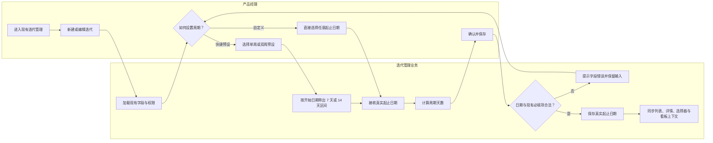
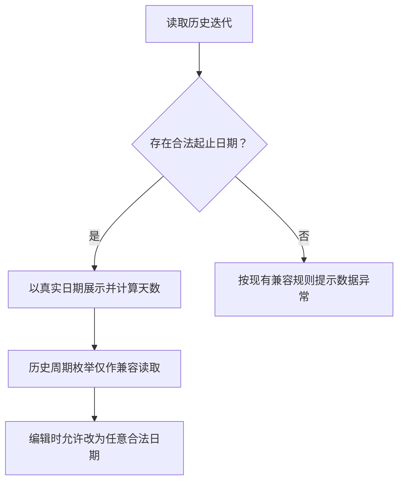

# F2 迭代管理优化—业务流程

## 1. 流程逻辑

产品经理继续从现有入口创建或编辑迭代。周期设置以真实起止日期为核心，单周和双周只负责快速带出日期。系统即时校验并计算周期天数，保存后所有迭代引用统一使用真实日期。

## 2. 创建或编辑迭代周期

## 3. 历史兼容流程

## 4. 业务规则

- 日期是周期的唯一事实来源。
- 单周/双周是快捷预设，不是持久化限制。
- 本期不新增临时迭代类型、权限或审批。
- 所有引用迭代周期的页面统一显示真实起止日期。

