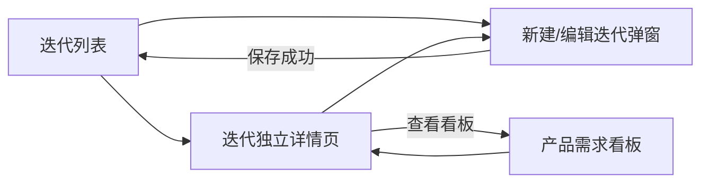

# PRD：迭代管理优化 2607_1

## 1. 文档信息

| 版本号 | 变更日期 | 变更内容 | 变更人 |
|---|---|---|---|
| v1.0 | 2026-07-20 | 基于已确认背景、概念设计和交互原型生成首版 PRD | 产品经理 |

### 1.1 关联文档链接

- [需求背景](./Background/Requirement_Background.md)
- [现有系统调研](./Background/System_Survey.md)
- [概念设计](./Background/Concept_Design.md)
- [用户故事](./Background/User_Stories.md)
- [用户旅程](./Flow/User_Journey_Map.md)
- [业务流程](./Flow/Business_Flow.md)
- [页面结构](./Page_Structure.md)
- [高保真交互原型](./Prototypes/iterations.html)

## 2. 项目概述

### 2.1 背景

现有迭代创建能力只能选择“单周”或“双周”，周期被限制为整周。实际业务中存在临时修复、专项交付和跨非整周日期的迭代，当前模型无法准确表达。本需求保持迭代管理页面结构、字段和权限不变，将周期改为由真实起止日期决定，单周和双周仅作为日期快捷预设。

### 2.2 产品目标

- 支持任意合法起止日期的迭代。
- 保留单周/双周的快捷创建效率。
- 实时计算和展示周期天数。
- 兼容历史迭代，无需人工迁移。
- 迭代列表、详情、选择器和看板统一使用真实日期。

### 2.3 成功标准

- 可创建不足 7 天、超过 14 天和跨非整周日期的迭代。
- 单周/双周预设分别正确生成连续 7/14 天。
- 非法日期无法保存，并在字段附近明确提示。
- 历史迭代继续正常展示和编辑。
- 页面结构和现有角色权限无意外变化。

### 2.4 范围

#### 本期包含

- 迭代新建/编辑表单的周期设置升级。
- 单周和双周日期快捷预设。
- 任意开始日期、结束日期及天数自动计算。
- 日期校验和错误反馈。
- 历史迭代读取兼容。
- 迭代列表、详情和看板上下文的真实日期同步。

#### 本期不包含

- 强制新增“临时迭代”类型。
- 迭代权限和审批流程重构。
- 自动排期、燃尽预测、跨团队资源核算。
- 右侧常驻详情栏。
- 无明确决策价值的顶部状态数量摘要卡。

## 3. 用户角色与故事

| 角色 | 核心目标 | 本期权限处理 |
|---|---|---|
| 产品经理 | 创建、编辑和管理任意周期迭代 | 沿用现有权限 |
| 产品负责人 | 查看迭代周期和交付状态 | 沿用现有权限 |
| 项目经理及其他授权角色 | 查看其有权访问的迭代 | 本期不新增权限 |

核心用户故事包括：

- 使用单周/双周预设创建常规迭代。
- 使用任意日期创建临时迭代。
- 即时发现并修正非法日期。
- 修改已有迭代周期。
- 无感兼容历史迭代。
- 从迭代进入对应产品需求看板。

详细验收标准见[用户故事](./Background/User_Stories.md)。

## 4. 业务流程

### 4.1 核心流程

1. 产品经理从现有入口新建或编辑迭代。
2. 用户选择单周/双周预设，或直接设置任意起止日期。
3. 系统实时计算周期天数。
4. 系统校验日期和现有必填字段。
5. 保存成功后，将真实日期同步到列表、详情、选择器和看板上下文。

完整业务流程见[业务流程](./Flow/Business_Flow.md)。

## 5. 页面结构与流转

### 5.1 页面流转逻辑

### 5.2 页面层级

| 页面 | 处理方式 | 说明 |
|---|---|---|
| 迭代列表 | 保持结构 | 调整周期显示，删除无价值摘要卡 |
| 新建/编辑迭代 | 局部改造 | 增加预设、可编辑日期和天数 |
| 迭代详情 | 保持结构 | 展示真实日期并联动看板 |
| 产品需求看板 | 跨需求复用 | 接收迭代筛选上下文 |

## 6. 名词字典与全局规则

### 6.1 名词字典

| 术语 | 定义 |
|---|---|
| 真实周期 | 由开始日期和结束日期共同定义的迭代日期区间 |
| 周期天数 | 开始日期和结束日期均计入的自然日数量 |
| 单周预设 | 从开始日期起连续 7 个自然日的快捷设置 |
| 双周预设 | 从开始日期起连续 14 个自然日的快捷设置 |
| 自定义周期 | 用户直接设置或修改预设结果后形成的任意合法日期区间 |
| 历史周期枚举 | 历史数据中的单周/双周类型，仅用于兼容读取，不再限制编辑 |

### 6.2 全局数据规则

| 规则项 | 定义 |
|---|---|
| 周期事实来源 | 开始日期和结束日期 |
| 天数公式 | `结束日期 - 开始日期 + 1` |
| 最短周期 | 1 天，即开始日期等于结束日期 |
| 日期合法性 | 结束日期不得早于开始日期 |
| 周数限制 | 不要求周期为 7 的整数倍 |
| 起止星期限制 | 不要求周一开始或周日结束 |
| 迭代排序 | 进行中、待启动、已完成、已归档；同状态按开始日期倒序 |
| 历史兼容 | 展示和计算以历史真实起止日期为准 |

## 7. 功能详细说明

### 7.1 迭代列表

- **原型链接**：[迭代管理](./Prototypes/iterations.html)

#### 数据来源与逻辑

- 读取现有迭代列表数据和权限。
- 周期展示使用开始日期和结束日期。
- 周期天数按自然日公式实时计算或由服务端统一返回。
- 状态和其他字段沿用现有数据模型。

#### 交互规则

- 页面标题后直接进入搜索、筛选和迭代列表。
- 不展示“进行中 / 待启动 / 本季度已完成”等大尺寸摘要卡。
- 日期展示格式为 `YYYY-MM-DD ～ YYYY-MM-DD`，并辅助展示 `N 天`。
- 点击记录进入独立迭代详情页。
- 列表默认按状态优先级和开始日期排序。

#### 异常与兜底

- 日期缺失或非法时显示数据异常标识，不在前端静默猜测日期。
- 列表加载失败时提供重试入口。
- 不允许通过右侧常驻栏降级展示迭代详情。

### 7.2 新建迭代

#### 数据来源与逻辑

- 名称、团队、目标、状态和其他现有字段保持不变。
- 开始日期和结束日期为周期事实来源。
- 单周/双周只负责带出日期。

#### 交互规则

- 在现有表单周期区域展示：
  - 单周预设。
  - 双周预设。
  - 开始日期。
  - 结束日期。
  - 周期天数。
- 用户可以跳过预设直接选择任意日期。
- 单周结束日期为开始日期加 6 天。
- 双周结束日期为开始日期加 13 天。
- 用户修改预设日期后显示“自定义 · N 天”。
- 保存按钮沿用现有创建权限。

#### 异常与兜底

- 未设置开始日期时选择预设，提示先设置开始日期。
- 结束日期早于开始日期时禁止保存。
- 日期错误提示显示在周期字段附近。
- 保存失败时保留用户输入和当前弹窗。
- 防止重复提交。

### 7.3 编辑迭代

#### 数据来源与逻辑

- 读取已有迭代真实起止日期。
- 历史周期枚举不反向覆盖日期。
- 现有迭代状态和权限限制继续生效。

#### 交互规则

- 打开编辑表单时展示真实日期和计算天数。
- 用户可修改为任意合法日期。
- 符合 7/14 天时可以弱提示周期长度，但不强制设置类型。
- 保存后刷新列表和详情中的日期。

#### 异常与兜底

- 无编辑权限时保持只读。
- 服务端拒绝修改时保留原数据并提示原因。
- 不因历史枚举缺失阻止合法日期保存。

### 7.4 周期预设与自定义日期

#### 数据来源与逻辑

- 预设运算基于用户选择的本地自然日期，不使用会造成跨时区偏移的 UTC 日期截取。
- 天数按日历日期计算，不受小时和时区影响。

#### 交互规则

- 选择单周后显示“预设 · 7 天”。
- 选择双周后显示“预设 · 14 天”。
- 手动修改任一日期后显示“自定义 · N 天”。
- 起止同一天显示“自定义 · 1 天”。

#### 异常与兜底

- 日期计算异常时禁止保存并提示重新选择。
- 客户端和服务端必须使用相同的自然日口径。
- 不允许出现双周预设显示 13 天等时区偏差。

### 7.5 迭代详情

#### 数据来源与逻辑

- 读取现有迭代详情及其需求关系。
- 周期统一使用真实起止日期和计算天数。
- 进度、需求及其他信息继续使用现有逻辑。

#### 交互规则

- 保持现有详情页面结构。
- 完整详情使用独立全宽页面。
- “查看看板”进入产品需求看板并应用当前迭代筛选。
- 不增加右侧常驻详情或判断栏。

#### 异常与兜底

- 迭代不存在或无权限时使用现有错误处理。
- 看板入口不可用时保留迭代详情，并提示无法打开看板。

### 7.6 历史迭代兼容

#### 数据来源与逻辑

- 优先读取历史记录的开始日期和结束日期。
- 历史单周/双周枚举仅作兼容信息。
- 若枚举与日期不一致，以日期为准。

#### 交互规则

- 用户无需批量迁移或重新保存历史迭代。
- 历史记录正常显示真实日期和天数。
- 编辑后按新规则保存日期。

#### 异常与兜底

- 历史记录缺少合法日期时显示数据异常，不根据枚举静默生成日期。
- 异常数据治理不阻塞其他正常迭代查看。

### 7.7 跨页面日期一致性

#### 数据来源与逻辑

- 迭代列表、迭代详情、产品需求所属迭代选择器和看板迭代上下文使用同一迭代日期数据。

#### 交互规则

- 修改日期成功后，各页面重新读取或同步最新日期。
- 需求所属迭代关系不因周期修改而自动变化。

#### 异常与兜底

- 局部同步失败时提示刷新，不展示推测值。
- 禁止同一迭代在不同页面显示相互矛盾的日期。

## 8. 非功能需求

### 8.1 数据一致性

- 客户端和服务端使用同一自然日天数公式。
- 日期保存成功后，所有引用页面最终一致。
- 周期修改不得破坏需求所属迭代关系。

### 8.2 兼容性

- 兼容已有单周/双周迭代。
- 兼容 1 天、非整周和超过 14 天的周期。
- 日期计算不得受客户端时区导致的日期偏移影响。

### 8.3 可用性

- 以桌面端 1440 × 900 为核心验收尺寸。
- 日期错误必须就近提示。
- 用户输入在保存失败后不得丢失。
- 页面保持现有信息架构，降低学习成本。

### 8.4 性能

- 日期预设和天数计算在本地即时完成。
- 保存后只刷新必要的迭代记录或详情数据。

### 8.5 安全与权限

- 创建、编辑、启动、完成和查看权限沿用现有规则。
- 本期不新增角色或审批权限。
- 服务端必须继续执行权限和日期合法性校验。

### 8.6 埋点建议

- 单周、双周、自定义周期的使用占比。
- 非整周迭代创建数量。
- 日期校验失败次数。
- 创建/编辑迭代保存成功率。

